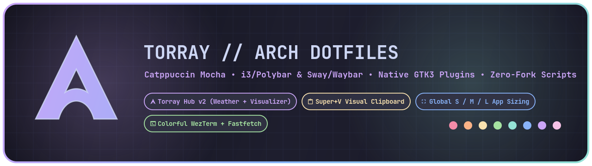
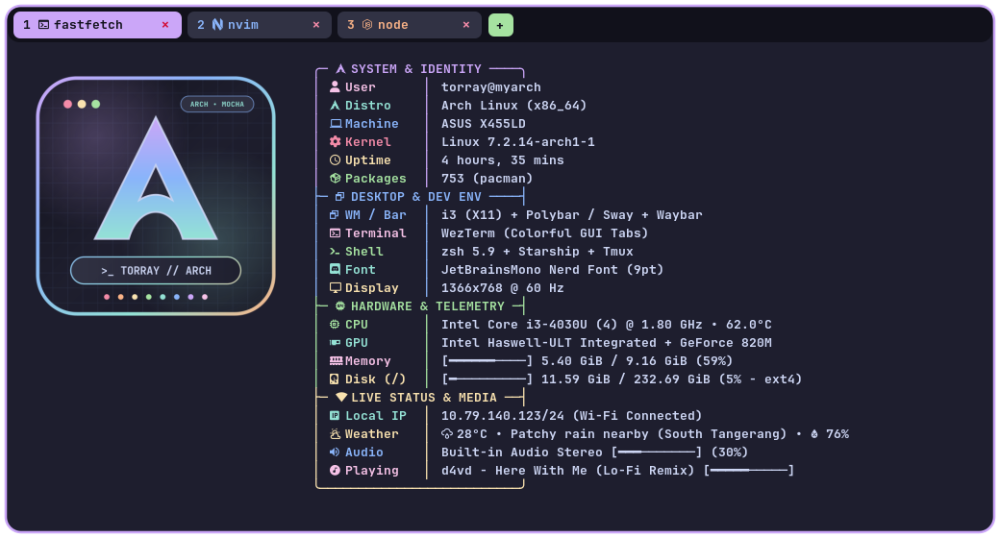
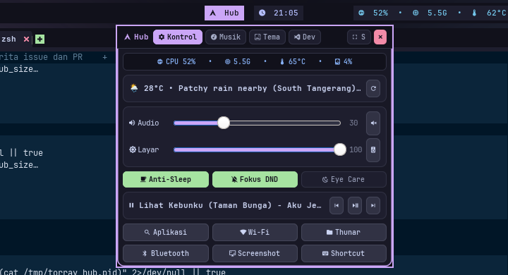
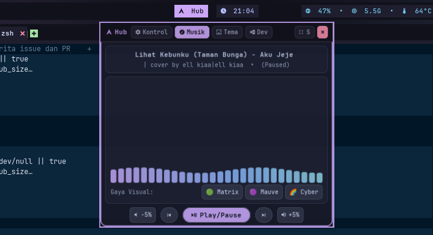
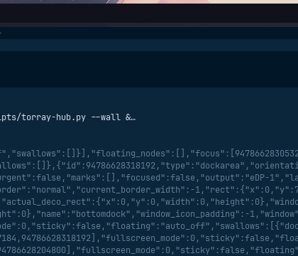
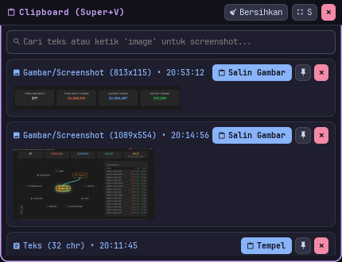

<div align="center">



# 󰣇 Torray Arch Dotfiles — Catppuccin Mocha

**A lightweight, zero-fork, developer-focused Arch Linux desktop environment (`i3 + Polybar` & `Sway + Waybar`) calibrated for `1366x768` displays with custom native GTK3 plugins.**


</div>

---

## 🖼️ Visual Showcase

### 1. Terminal & Fastfetch
**WezTerm** has per-tab Catppuccin color badges and process icons. **Alacritty** opens Zsh with history-based inline suggestions: press **Right Arrow** at the end of the line or **Ctrl+F** to accept, **Tab** for completion, and **Ctrl+R** to search command history. Suggestions use local history, not an AI service, and are not executed until you press Enter.

**Fastfetch** now shows a compact, two-section summary: user, OS, kernel, uptime, packages, desktop, terminal, shell, CPU, memory, and disk. The built-in Arch logo works in Alacritty as well as WezTerm. Weather remains in Torray Hub only.

The illustration below shows the earlier, expanded Fastfetch layout, not the current compact configuration:

<div align="center">
  
</div>

---

### 2. Centered `Torray Hub v2` (Native GTK3 Control Center)
Accessible right from the center of the navbar (`[  Hub ]` or `Super + N` / `Super + P` / `Super + Shift + W`), **Torray Hub v2** drops down at the top-center of your screen with **4 specialized tabs** and a dynamic **`[ 󰊓 S / M / L ]`** window size switcher:

| `󰒓 Control & Live Weather` (`Super + N`) | `󰎆 28-Bar Audio Visualizer` (`Super + P`) | `󰸉 6 Themes & HD Wallpapers` (`Super + Shift + W`) |
| :---: | :---: | :---: |
|  |  |  |
| **Pure-Python Telemetry** (`CPU / RAM / Temp / Disk`), **Live Local Weather (`wttr.in`)**, **Volume & Brightness Sliders**, and **Smart Toggles** (`Anti-Sleep`, `DND Focus`, `Eye Care`). | **60 FPS Cairo Spectrum Equalizer** with **3 color themes** (`🌈 Cyber`, `🟣 Mauve`, `🟢 Matrix`) and full MPRIS media controls. | **6 Desktop Presets** (`Mocha`, `Tokyo`, `Sakura`, `Emerald`, `Cosmos`, `Crimson`), **12 Curated HD Wallpapers**, and **Live Window Gaps Tweaker** (`0px / 4px / 10px`). |

---

### 3. `Torray Clip` — Windows 11-Style Visual Clipboard (`Super + V`)
An event-driven GTK3 clipboard manager with RGBA visual transparency and Picom blur that captures **both copied text snippets AND screenshots/images** with visual thumbnails, instant search filtering, item pinning (`󰐃`), one-click auto-paste (`󰅌`), and resizable `S / M / L` presets:

<div align="center">
  
</div>

---

## ✨ Key Architecture & Performance Highlights

- **Frosted Glass Blur & Translucency (`Picom v13 Dual-Kawase`)**:
  - **GPU-Accelerated Blur**: Enabled `dual_kawase` blur (strength 5) with zero frame tearing on Intel Haswell iGPU.
  - **Translucent Elements**: Polybar navbar (`#cc11111b` dock with `#e61e1e2e` floating pills), WezTerm (`90%` opacity), Torray Hub (`rgba(24, 24, 37, 0.90)`), Torray Clip, and Rofi menus all receive smooth frosted glass backdrop blur.
- **Global Desktop Theme Engine (`theme-engine.sh`)**:
  - Switch entire system themes on-the-fly (`🟣 Mocha`, `🔵 Tokyo Cyber`, `🌸 Sakura Sunset`, `🟢 Emerald Matrix`, `🟠 Cosmos Gold`, `🔴 Crimson Abyss`).
  - Instantly synchronizes Polybar bar colors, i3 window borders, Rofi palettes, GTK3 plugin accents, and matches curated high-resolution wallpapers.

- **Proportional Inset-Pill Navbar (`Polybar` & `Waybar`)**:
  - **Live App Logos inside Workspaces (`workspaces.py`)**: Subscribes directly to the i3/Sway IPC socket (`0.0% idle CPU`) and renders live Nerd Font icons (`󰆍` WezTerm, `󰨞` VS Code, `󰈹` Firefox, `󰉋` Thunar, `` Neovim, `󰻠` btop) inside each workspace pill.
  - **Dynamic Center Music Equalizer (`media.sh`)**: The animated music pill (`󰎆 ▂▅▇▃ Song Title`) automatically appears in the center of the bar **only when audio is actively `Playing`**, and hides cleanly when paused or stopped. Clicking it opens `Torray Hub` directly on the Music Visualizer tab.
  - **Zero-Fork Bash Builtin Scripts**: `sysinfo.sh`, `net.sh`, `power-status.sh`, and `clock.sh` read `/proc/stat`, `/proc/meminfo`, `/proc/net/wireless`, and `/sys/class/power_supply` directly using pure Bash builtins (`read`, `printf '%(...)T'`) without spawning `awk`, `sed`, `free`, `cat`, or `sleep` subprocesses.
- **Smart Window Sizing (`win-layout.sh`)**:
  - **`Super + F` (Full Below Navbar)**: Maximizes the active window to `1356x723` right below the navbar—keeping the top bar and your browser tabs visible at all times.
  - **`Super + Shift + F` (True Fullscreen)**: Triggers hardware fullscreen (hiding the navbar) for cinema/video playback.
  - **`Super + Z` (Global Size Cycle)**: Cycles any window through **`S` (`720x460`) → `M` (`980x600`) → `L` (`1200x680`) → `Full` (`Tiling`)**, also clickable directly from the navbar's `[ 󰊓 Full ]` pill.
- **Developer Utilities Built Into `Torray Hub` (`󰨞 Dev` Tab)**:
  - **Localhost Port Killer**: Scans active listening TCP ports (`:3000`, `:5173`, `:8000`, `:8080`, etc.) and lets you terminate stuck Node/Python/Go servers with a single click.
  - **Screen Color Picker**: Samples any pixel on screen and copies its `#HEX` code straight to your clipboard.
- **Custom Catppuccin `Thunar` File Manager**:
  - Styled with a dark Mocha `gtk.css` theme, developer sidebar bookmarks, compact icon view, and custom right-click actions (`Open Terminal Here`, `Open in VS Code`, `Copy Path`).

---

## ⌨️ Keyboard Shortcuts Reference

### 🚀 Core Applications & Custom Plugins
| Shortcut | Action |
| :--- | :--- |
| **`Super + N`** | Open **Torray Hub** (`󰒓 Control & Live Weather` tab) |
| **`Super + P`** | Open **Torray Hub** (`󰎆 Music & 28-Bar Visualizer` tab) |
| **`Super + Shift + W`** | Open **Torray Hub** (`󰸉 Wallpaper Studio & Theme` tab) |
| **`Super + V`** | Open **Torray Clip** (Visual Text & Screenshot Clipboard History) |
| **`Super + T`** / **`Super + Enter`** | Launch **WezTerm** Terminal |
| **`Super + C`** | Launch **VS Code** |
| **`Super + E`** | Launch **Thunar** File Manager |
| **`Super + B`** | Launch **Firefox** Browser |
| **`Super + Space`** | Open **Rofi** Application Launcher |
| **`Super + /`** / **`Super + Ctrl + K`** | Open Interactive **Keybindings Search Menu** |
| **`Super + X`** | Open **Power Menu** (`Lock`, `Logout`, `Reboot`, `Shutdown`) |
| **`Super + Q`** | Close Focused Window |

### 📐 Window Sizing, Layout & Navigation
| Shortcut | Action |
| :--- | :--- |
| **`Super + F`** | **Full Window Below Navbar** (Navbar & browser tabs remain visible) |
| **`Super + Shift + F`** | **True Max Fullscreen** (Hides navbar / cinema mode) |
| **`Super + Z`** | Cycle Active Window Size: **`S` → `M` → `L` → `Full`** |
| **`Super + Shift + Space`** | Toggle Floating Mode (auto-centered at `900x540`) |
| **`Super + Alt + 1 / 2 / 3 / 4 / 0`** | Quick Size Presets: `[1]` Small, `[2]` Medium, `[3]` Large, `[4]` PiP Corner, `[0]` Tiling |
| **`Super + Ctrl + Shift + Arrows`** | Fine-grain manual window resize (Width / Height) |
| **`Super + =`** / **`Super + -`** | Grow / Shrink window width & height simultaneously |
| **`Super + Arrows`** or **`H / J / K / L`** | Move focus between windows |
| **`Super + Shift + Arrows`** | Move window position |
| **`Super + 1..9, 0`** | Switch to Workspace `1 – 10` |
| **`Super + Shift + 1..9, 0`** | Move window to Workspace `1 – 10` **and follow it automatically** |

### 📸 Screenshots & Hardware Controls
| Shortcut | Action |
| :--- | :--- |
| **`Print`** / **`Super + Shift + S`** | Interactive Area Screenshot (Copied to clipboard & saved to `Torray Clip`) |
| **`Shift + Print`** | Fullscreen Screenshot saved to `~/Pictures/Screenshots/` |
| **`XF86AudioRaiseVolume / Lower`** | Volume Up / Down (`±5%`) with live OSD notification |
| **`XF86MonBrightnessUp / Down`** | Screen Brightness Up / Down (`±5%`) with live OSD notification |

---

## 📂 Repository Structure (GNU Stow Ready)

```text
~/dotfiles
├── assets/         # Visual banners, Fastfetch preview, and GTK3 plugin screenshots
├── alacritty/      # Alacritty terminal config (Catppuccin Mocha)
├── btop/           # btop++ system monitor config & theme
├── dunst/          # Dunst X11 notification daemon
├── fastfetch/      # Compact system summary + optional custom Cyber Arch logo
├── foot/           # Foot Wayland terminal config
├── gtk/            # GTK-3.0 / GTK-4.0 dark theme, Thunar CSS, and sidebar bookmarks
├── i3/             # i3wm X11 window manager config (1366x768 calibrated)
├── kitty/          # Kitty terminal config
├── mako/           # Mako Wayland notification daemon
├── nvim/           # Neovim Lua configuration
├── picom/          # Picom v13 compositor (GLX tear-free + smooth spring animations)
├── polybar/        # Polybar config + Torray Hub + Torray Clip + zero-fork scripts
├── rofi/           # Rofi launcher, Wi-Fi menu, powermenu, and keybinding viewer
├── starship/       # Starship cross-shell prompt
├── sway/           # Sway Wayland compositor config
├── thunar/         # Thunar file manager settings & custom right-click actions
├── tmux/           # Tmux multiplexer config
├── vscode/         # VS Code settings (Catppuccin + JetBrainsMono Nerd Font)
├── waybar/         # Waybar config & CSS matching the Polybar inset-pill layout
├── wezterm/        # WezTerm config with colorful GUI tabs & Kitty graphics protocol
└── zsh/            # Zsh configuration, aliases, and autosuggestions
```

---

## ⚡ Quick Installation

Clone this repository into `~/dotfiles` and run the automated `GNU Stow` installer:

```bash
git clone https://github.com/Torrayz/arch-dotfiles.git ~/dotfiles
cd ~/dotfiles
./install.sh
```

Reload your window manager anytime with **`Super + Shift + R`** (`i3`) or **`Super + Shift + C`** (`Sway`).
